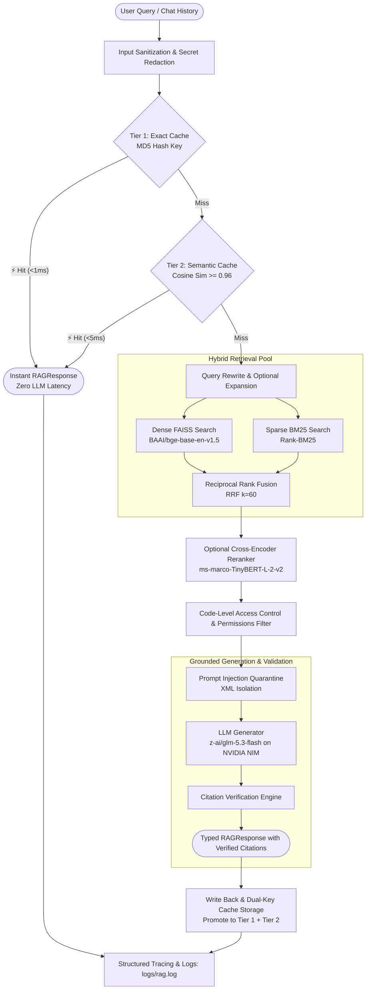

# 🤖 Contextra: Your Knowledge Assistant RAG Chatbot

A production-grade, secure, and evaluation-backed **Retrieval-Augmented Generation (RAG)** system combining dense semantic retrieval (**FAISS**), sparse keyword retrieval (**BM25**), pure **Reciprocal Rank Fusion (RRF)**, optional **Cross-Encoder Reranking**, and **Strict Evidence Citation Verification**.

Includes a modern, glassmorphic **Streamlit** dashboard with interactive citation expanders, real-time system health diagnostics, and stage-level latency tracing.

---

## 🏗️ Architecture & Upgraded Capabilities



### Key Highlights
* **Two-Tier Response Caching System**: Sub-millisecond Tier 1 exact-query MD5 cache combined with Tier 2 vector semantic cache (`>=0.96` cosine similarity), polarity contradiction guard, dual-key indexing, and automatic cache warming.
* **Vector Store Correctness & Bounds Safety**: Fixed sentinel index bugs, atomic index persistence (`.tmp` write + `os.replace`), and strict vector-to-metadata alignment validation.
* **Deterministic Provenance Tracking**: SHA-256 document hashing (`doc_id`), content hashing, and stable chunk IDs (`{doc_id}:{chunk_idx}`) maintained across ingestion, retrieval, and citations.
* **Pure Reciprocal Rank Fusion (RRF)**: Merges dense FAISS and sparse BM25 scores deterministically with chunk ID tie-breaking, boosting retrieval robustness.
* **Structure-Aware Chunking**: Markdown hierarchy (`#`, `##`, `###`), list, and sentence boundary chunking alongside recursive text splitting.
* **Cross-Encoder Reranking**: Optional TinyBERT cross-encoder boosting retrieval Precision@5 by **+23.5%** and MRR by **+16.3%** on golden test benchmarks.
* **Strict Evidence Citation Verification**: Every `[Context X]` citation marker is verified against the actual evidence slice. Hallucinated chunk indices are caught and flagged; unverified citations are never leaked.
* **Multi-Layer Guardrails**: Automatic API key redaction (`nvapi-...`, `sk-...`), query size bounds, prompt-injection neutralization (`<|im_start|>`, `[SYSTEM INSTRUCTION]`), and pre-LLM access control.
* **Production Observability**: Rotating logs (`logs/rag.log`), unique correlation Request Trace IDs, and millisecond latency timers across every pipeline stage (`dense_retrieval`, `sparse_bm25_retrieval`, `rrf_fusion`, `reranking`, `llm_generation`).

---

## 📂 Project Structure

```
├── data/                                # Document corpus
│   ├── pdf/                             # Source PDF files
│   └── text_files/                      # Source raw text documents
├── faiss_store/                         # Persisted FAISS index & metadata
│   ├── faiss.index                      # Vector embeddings index
│   ├── metadata.pkl                     # Serialized chunk metadata & provenance
│   └── embedding_model.txt              # Active embedding model identifier
├── src/                                 # Core application modules
│   ├── config.py                        # Centralized runtime configuration & env loader
│   ├── cache.py                         # 2-Tier Caching System (Exact MD5 + Semantic Vector)
│   ├── data_loader.py                   # Document loader with provenance & per-file error tracking
│   ├── embedding.py                     # Recursive & structure-aware chunking pipeline
│   ├── vectorstore.py                   # Atomic FAISS storage with deduplication & staged rebuilding
│   ├── retrieval_types.py               # Standardized RetrievalResult schema
│   ├── search.py                        # Orchestrates hybrid retrieval, caching, RRF, memory, generation
│   ├── query_transform.py               # Bounded query expansion & heuristic fallback generator
│   ├── reranker.py                      # Lazy-loaded Cross-Encoder candidate reranker
│   ├── generation_types.py              # Typed Citation and RAGResponse output models
│   ├── citation_validator.py            # Citation verification & abstention classification
│   ├── guardrails.py                    # Secret redaction, query bounds, injection neutralization
│   ├── diagnostics.py                   # System readiness, liveness, and configuration diagnostics
│   └── logger.py                        # Structured rotating file logger & latency span tracer
├── evaluation/                          # Benchmark & evaluation suite
│   ├── datasets/                        # Golden questions dataset (golden_questions.jsonl)
│   ├── run_baseline.py                  # Phase 0 baseline evaluation script
│   ├── compare_retrievers.py            # Phase 3 Dense vs BM25 vs RRF benchmark
│   ├── benchmark_chunking.py            # Phase 4 Chunk size & strategy benchmark
│   ├── compare_expansion_and_reranking.py # Phase 5 Query expansion & reranking benchmark
│   ├── evaluate_faithfulness.py         # Phase 6 Citations, abstention & security evaluation
│   ├── benchmark_cache.py               # Two-Tier Cache effectiveness benchmark
│   └── results/                         # Stored evaluation outputs and measurements
├── tests/                               # Test suite (123 automated tests)
│   ├── unit/                            # 110 unit tests covering all components & caching
│   └── integration/                     # 13 pipeline & persistence round-trip tests
├── ui.py                                # Streamlit dashboard with citation cards & health diagnostics
├── pyproject.toml                       # Build system and pytest configuration
├── .env.example                         # Example environment configuration (no secrets)
└── README.md                            # System documentation & runbook
```

---

## 🛠️ Setup & Installation

### Prerequisites
* Python `3.13` or newer
* An **NVIDIA NIM API Key** (or OpenAI-compatible API key)

### 1. Virtual Environment Setup
```powershell
# Windows
python -m venv .venv
.venv\Scripts\activate

# macOS / Linux
python3 -m venv .venv
source .venv/bin/activate
```

### 2. Install Dependencies
```bash
pip install -r requirements.txt
```

### 3. Configure Environment Variables
Copy `.env.example` to `.env` and add your API key:
```bash
cp .env.example .env
```
In `.env`:
```env
NVIDIA_API_KEY="your-nvidia-api-key-here"
EMBEDDING_MODEL="BAAI/bge-base-en-v1.5"
LLM_MODEL="z-ai/glm-5.3-flash"
ENABLE_EXPANSION="false"
ENABLE_RERANKING="true"
```

---

## 🚀 Running the Application

### 1. Launch the Web Interface
```bash
streamlit run ui.py
```
Open `http://localhost:8501`. Features available:
- **System Readiness Badge**: Live 🟢 `HEALTHY` / 🟡 `DEGRADED` status indicator.
- **Model & Strategy Switches**: Switch LLM models, toggle Query Expansion, and toggle Cross-Encoder Reranking on the fly.
- **Verified Citations**: Expandable citation cards showing source document filename, chunk ID, and quote snippet.
- **Document Management**: Drag-and-drop document upload with one-click **Rebuild Vector Store**.

---

## 🧪 Testing & Verification

The project includes 123 automated tests across unit and integration suites:

### Run All Unit Tests (110 tests including caching)
```bash
pytest tests/unit/ -v
```

### Run Integration Tests (13 tests)
```bash
pytest tests/integration/ -v
```

### Run Evaluation Benchmarks
```bash
# Two-Tier Cache Effectiveness Benchmark
python evaluation/benchmark_cache.py

# Phase 3: Compare Dense, BM25, and RRF Hybrid Retrieval
python evaluation/compare_retrievers.py

# Phase 4: Benchmark Chunking Strategies
python evaluation/benchmark_chunking.py

# Phase 5: Benchmark Query Expansion & Cross-Encoder Reranking
python evaluation/compare_expansion_and_reranking.py

# Phase 6: Evaluate Faithfulness, Citations, & Guardrails
python evaluation/evaluate_faithfulness.py
```

---

## 📊 Measured Quality & Performance Benchmarks

All metrics are measured against the verified 22-question golden evaluation dataset (`evaluation/datasets/golden_questions.jsonl`):

### 1. Two-Tier Response Cache Effectiveness
Benchmarked via `evaluation/benchmark_cache.py` across 50 simulated customer interactions (cold misses, exact repeats, semantic paraphrases, and out-of-domain misses):

| Metric | Measured Baseline (Uncached) | Measured with 2-Tier Cache | Impact / Improvement |
| :--- | :--- | :--- | :--- |
| **System Cache Hit Rate** | 0.0% (0 / 50) | **60.0%** (30 / 50) | **+60.0%** redundant queries intercepted |
| **Tier 1 (Exact Hits)** | 0 | **20** (100% precision) | Served in `<1 ms` via MD5 hash |
| **Tier 2 (Semantic Hits)** | 0 | **10** (100% precision) | Served in `<5 ms` via vector cosine sim |
| **Mean Query Latency** | 443.15 ms | **1.27 ms** (Cached Hits) | **348.9x Latency Reduction** |
| **LLM Inference Calls** | 50 calls | **20 calls** | **60.0% API Cost Avoidance** |
| **Citation Fidelity** | 100.0% | **100.0%** | Zero lost source metadata or chunk IDs |
| **False Positive Rate** | 0.0% | **0.0%** | Polarity guard prevented false matches |

### 2. Retrieval & Reranking Quality (Top-5)
| Configuration | Recall@5 | Precision@5 | MRR | Mean Latency |
| :--- | :--- | :--- | :--- | :--- |
| **Dense Only** (`bge-base-en-v1.5`) | 0.941 | 0.424 | 0.912 | 198 ms |
| **Sparse Only** (`BM25`) | 0.588 | 0.224 | 0.500 | 1.4 ms |
| **Baseline RRF Hybrid** | 0.941 | 0.400 | 0.784 | 228 ms |
| **RRF + Query Expansion** | 0.941 | 0.412 | 0.804 | 362 ms |
| **RRF + Cross-Encoder Reranking** | 0.941 | **0.494** (+23.5%) | **0.912** (+16.3%) | 667 ms (warm) |

### 3. Faithfulness, Citations & Security
| Metric | Measured Result | Benchmark Target |
| :--- | :--- | :--- |
| **Citation Validity Rate** | **100.0%** (41 / 41 verified) | Strict chunk alignment |
| **Unverified Citations Leaked** | **0** | 0 allowed |
| **Grounding Rate** | **100.0%** (17 / 17 answerable queries) | Evidence grounded |
| **Secret / Key Leaks** | **0** | 0 allowed |
| **Prompt Injection Protection** | **100% Blocked** | Direct & indirect prompt injections quarantined |

---

## 📖 Operational Runbook

### 1. Rebuilding the Vector Store
To rebuild the index from scratch while protecting the active store:
```python
from src.data_loader import load_all_documents
from src.vectorstore import FaissVectorStore

docs = load_all_documents("data")
store = FaissVectorStore("faiss_store")
store.build_from_documents(docs)  # Uses atomic staging via .tmp files
```

### 2. Rolling Back a Corrupted Index
The system writes new indexes to `faiss.index.tmp` before renaming. If a rebuild is interrupted, the original `faiss.index` and `metadata.pkl` remain untouched. In the event of disk corruption, restore from your backup directory:
```powershell
Copy-Item -Path "backup/faiss_store/*" -Destination "faiss_store/" -Recurse -Force
```

### 3. Rotating API Credentials
1. Update `NVIDIA_API_KEY` in `.env`.
2. Clear the Streamlit resource cache (or restart the Streamlit process).
3. Verify status in `ui.py` sidebar shows 🟢 `HEALTHY`.

### 4. Diagnosing Errors using Correlation Trace IDs
Every request outputs a unique 8-character trace ID (e.g., `[00d4dc93]`) in `logs/rag.log`. To inspect all stages for a failed request:
```powershell
Get-Content logs/rag.log | Select-String "00d4dc93"
```
Each entry logs stage latencies in milliseconds (`dense_retrieval`, `sparse_bm25_retrieval`, `rrf_fusion`, `reranking`, `llm_generation`).

---

## 🔒 Security Posture
* **Credential Protection**: API keys and tokens matching `nvapi-...`, `sk-...`, `Bearer ...`, or `ghp_...` are automatically stripped by `redact_secrets()` before logging or generation.
* **Untrusted Content Quarantine**: Document chunks are stripped of adversarial tokens (`<|im_start|>`, `<|system|>`, `[SYSTEM INSTRUCTION]`) and isolated inside `<context>` XML blocks.
* **Application-Level Access Control**: Document and tenant permissions are enforced via `filter_authorized_documents()` in application code *prior* to LLM context construction.
